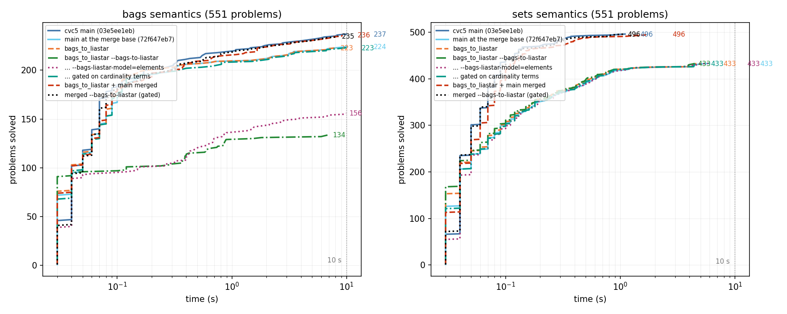

# cvc5 main vs `bags_to_liastar` on the spes SQL equivalence benchmarks

Date: 2026-09-28. Timeout 10 s per problem (spes's own setting), 8 problems in parallel on an 18-core machine. All binaries are `unrestricted` (release) builds with `--gpl --normaliz --poly`.

## Problems

1102 SMT-LIB problems, one per query pair that the spes translator encodes, generated with the current translator (`SimpleQueryTests.Cvc5Analysis` in batch mode, one run per `testData/*.json` file, once under bag semantics and once under set semantics), then split into one file per problem. Dropped from the files: `tlimit-per` (the timeout is given on the command line), `get-model`/`get-value` and the answer comments spes appends after solving, and `(set-option :bags-map-up-pair true)`, which 485 bag-semantics problems carry and neither cvc5 under test has (both lack the `bags-map-up-pair` branch, so key constraints are asserted but cannot be contradicted by two rows sharing a key). `produce-models`, `check-models`, `dag-thresh 0`, `uf-lazy-ll`, `fmf-bound`, `strings-exp` stay as spes sets them.

| batch | pairs | problems (bags) | problems (sets) |
|---|---|---|---|
| bags | 3 | 3 | 3 |
| calcite_tests | 232 | 124 | 124 |
| no_aggregation | 97 | 88 | 88 |
| no_aggregation_no_null | 101 | 62 | 62 |
| no_aggregation_no_null_no_cast | 93 | 61 | 61 |
| no_aggregation_no_null_no_cast_no_outer_join | 71 | 49 | 49 |
| no_aggregation_sat | 85 | 85 | 85 |
| spark_tests | 127 | 79 | 79 |
| **total** | 809 | 551 | 551 |

None of the 551 bag-semantics problems contains a `bag.card` term: they are built from `table.project`, `bag.filter`, `bag.setof`, `table.product`, `bag.map`, `bag.count`, `bag.union_disjoint`, `bag.difference_remove`, `table.aggr`.

## Headline

| configuration | bags: solved (sat / unsat / timeout / unknown) | sets: solved (sat / unsat / timeout / error) |
|---|---|---|
| main 03e5ee1eb (Sep 25) | **237** (74 / 163 / 314 / 0) | **496** (78 / 418 / 52 / 3) |
| main at the merge base 72f647eb7 (Sep 22) | **224** (62 / 162 / 327 / 0) | **433** (36 / 397 / 118 / 0) |
| bags_to_liastar 34083d6d8 | **223** (61 / 162 / 328 / 0) | **433** (36 / 397 / 118 / 0) |
| bags_to_liastar, --bags-to-liastar | **134** (18 / 116 / 396 / 21) | **433** (36 / 397 / 118 / 0) |
| bags_to_liastar, --bags-to-liastar --bags-liastar-model=elements | **156** (39 / 117 / 395 / 0) | **433** (36 / 397 / 118 / 0) |
| bags_to_liastar, --bags-to-liastar --dio-solver | **133** (18 / 115 / 396 / 22) | **433** (36 / 397 / 118 / 0) |
| bags_to_liastar, --bags-to-liastar, gated on cardinality terms (uncommitted) | **223** (61 / 162 / 327 / 1) | **433** (36 / 397 / 118 / 0) |
| merged: bags_to_liastar + main | **236** (73 / 163 / 315 / 0) | **496** (78 / 418 / 52 / 3) |
| merged, --bags-to-liastar | **140** (18 / 122 / 390 / 21) | **496** (78 / 418 / 52 / 3) |
| merged, --bags-to-liastar --bags-liastar-model=elements | **162** (39 / 123 / 389 / 0) | **496** (78 / 418 / 52 / 3) |
| merged, --bags-to-liastar, gated | **235** (72 / 163 / 315 / 1) | **496** (78 / 418 / 52 / 3) |

0 disagreements between any two configurations on the problems both solve. The 3 errors are `check-models` failures of main's sets code on aggregate queries (`calcite_tests__sets/testAggregateConstantKeyRule{,2}`, `testPushFilterPastAgg`: `Fatal failure within CheckModels::checkModel`); they come with commit 7d2e7e02c and are inherited by the merged build.

## What the numbers say

1. **The branch itself is neutral.** `bags_to_liastar` (34083d6d8) and main at its merge base (72f647eb7, Sep 22) solve the same problems (223 vs 224 bags, 433 vs 433 sets; +0 / -1). The branch's non-liastar changes (arith rewriter hooks for `int.star-contains`, the LIA* extension, the kinds, the Diophantine default) do not change what is solved.
2. **All of main's lead is one commit.** main (03e5ee1eb, Sep 25) solves 237 / 496 against the merge base's 224 / 433: +77 / -1, and the only one of the 17 commits after the merge base that touches solving is `7d2e7e02c Optimize bag.map rules for injective functions (#12007)` (Sep 24), which changes both `theory/bags` and `theory/sets/theory_sets_private.cpp`. Merging current main into the branch (scratch worktree `~/cvc5/branch-merged`, two trivial conflicts) gives 236 / 496: main's numbers.
3. **`--bags-to-liastar` as committed hurts these problems: -90 on the branch, -97 on the merged build (bags semantics; sets are untouched by the option).** 21 answers become `unknown` (the subsolver model mode declines to build a model when fresh elements are needed inside `bag.map`/`bag.filter`, which is every SQL query), and ~70 more time out. The profile of one of them, `calcite_tests__bags/testMergeUnionAll` (branch: unsat in 0.10 s), shows where the time goes: the star has 87 slots, and `theory::arith::liastar::checkFullEffortTime` is 9.98 s of the 10 s. The star is built because `q1 != q2` is a bag atom, yet without a single cardinality term it can only restate pointwise facts the element-wise rules derive anyway. The Diophantine default is not the cause: `--bags-to-liastar --dio-solver` gives 133 (vs 134).
4. **`--bags-liastar-model=elements` recovers the `unknown`s** (156 vs 134 on the branch, 162 vs 140 merged): its fresh elements are terms the theory reasons about, so `bag.map`/`bag.filter` models get built. It does not recover the timeouts.
5. **Gating the translation on the presence of a cardinality term makes the option neutral here** (223 vs 223 on the branch, 235 vs 236 merged) while leaving the cardinality benchmarks exactly as they were (the 480 `fol_*` files: 296 sat / 184 unsat / 0 timeouts, 89 s total with the gated binary). The gate is a three-line change, uncommitted in `~/cvc5/12572`: `checkLiastarConstraints` returns when the context has no cardinality term, and `mapCard` / the `mapDown` cardinality conjunct are only added once one is present, so the translation cannot bootstrap itself into a problem that asks nothing about cardinalities. The one residual `unknown` is `spark_tests__bags/39` (branch: sat 0.09 s): it has a `table.aggr`, whose fold reduction introduces a cardinality term, so the star is built and the model cannot be read back. All 110 bags regressions pass with the gate.

## Time on the problems every configuration solves

564 problems.

| configuration | total | median | max |
|---|---|---|---|
| main 03e5ee1eb (Sep 25) | 31.1 s | 0.040 s | 0.55 s |
| main at the merge base 72f647eb7 (Sep 22) | 105.2 s | 0.040 s | 5.99 s |
| bags_to_liastar 34083d6d8 | 97.7 s | 0.040 s | 4.60 s |
| bags_to_liastar, --bags-to-liastar | 120.9 s | 0.040 s | 7.09 s |
| bags_to_liastar, --bags-to-liastar --bags-liastar-model=elements | 134.8 s | 0.045 s | 6.74 s |
| bags_to_liastar, --bags-to-liastar --dio-solver | 152.8 s | 0.050 s | 8.94 s |
| bags_to_liastar, --bags-to-liastar, gated on cardinality terms (uncommitted) | 103.8 s | 0.040 s | 4.54 s |
| merged: bags_to_liastar + main | 43.3 s | 0.040 s | 1.66 s |
| merged, --bags-to-liastar | 55.2 s | 0.040 s | 5.81 s |
| merged, --bags-to-liastar --bags-liastar-model=elements | 48.5 s | 0.040 s | 4.54 s |
| merged, --bags-to-liastar, gated | 35.6 s | 0.040 s | 0.80 s |

main is 3x faster than the merge base on the common problems (31 s vs 105 s), again #12007; the merged build is at 43 s. The gated option costs nothing measurable (104 s vs 98 s on the branch).

## Per batch

sat / unsat / timeout (+ unknown where nonzero).

| batch | sem. | n | main | branch | branch +liastar | branch +liastar +elements | branch +liastar gated | merged | merged +liastar gated |
|---|---|---|---|---|---|---|---|---|---|
| bags | bags | 3 | 0 / 3 / 0 | 0 / 3 / 0 | 0 / 3 / 0 | 0 / 3 / 0 | 0 / 3 / 0 | 0 / 3 / 0 | 0 / 3 / 0 |
| bags | sets | 3 | 0 / 3 / 0 | 0 / 3 / 0 | 0 / 3 / 0 | 0 / 3 / 0 | 0 / 3 / 0 | 0 / 3 / 0 | 0 / 3 / 0 |
| calcite_tests | bags | 124 | 0 / 23 / 101 | 0 / 23 / 101 | 0 / 14 / 110 | 0 / 15 / 109 | 0 / 23 / 101 | 0 / 23 / 101 | 0 / 23 / 101 |
| calcite_tests | sets | 124 | 1 / 81 / 39 | 1 / 75 / 48 | 1 / 75 / 48 | 1 / 75 / 48 | 1 / 75 / 48 | 1 / 81 / 39 | 1 / 81 / 39 |
| no_aggregation | bags | 88 | 1 / 35 / 52 | 1 / 35 / 52 | 0 / 26 / 61 (+1 unk) | 1 / 26 / 61 | 1 / 35 / 52 | 1 / 35 / 52 | 1 / 35 / 52 |
| no_aggregation | sets | 88 | 1 / 85 / 2 | 0 / 81 / 7 | 0 / 81 / 7 | 0 / 81 / 7 | 0 / 81 / 7 | 1 / 85 / 2 | 1 / 85 / 2 |
| no_aggregation_no_null | bags | 62 | 0 / 18 / 44 | 0 / 18 / 44 | 0 / 9 / 53 | 0 / 9 / 53 | 0 / 18 / 44 | 0 / 18 / 44 | 0 / 18 / 44 |
| no_aggregation_no_null | sets | 62 | 0 / 60 / 2 | 0 / 57 / 5 | 0 / 57 / 5 | 0 / 57 / 5 | 0 / 57 / 5 | 0 / 60 / 2 | 0 / 60 / 2 |
| no_aggregation_no_null_no_cast | bags | 61 | 0 / 17 / 44 | 0 / 17 / 44 | 0 / 8 / 53 | 0 / 8 / 53 | 0 / 17 / 44 | 0 / 17 / 44 | 0 / 17 / 44 |
| no_aggregation_no_null_no_cast | sets | 61 | 0 / 59 / 2 | 0 / 56 / 5 | 0 / 56 / 5 | 0 / 56 / 5 | 0 / 56 / 5 | 0 / 59 / 2 | 0 / 59 / 2 |
| no_aggregation_no_null_no_cast_no_outer_join | bags | 49 | 0 / 17 / 32 | 0 / 17 / 32 | 0 / 8 / 41 | 0 / 9 / 40 | 0 / 17 / 32 | 0 / 17 / 32 | 0 / 17 / 32 |
| no_aggregation_no_null_no_cast_no_outer_join | sets | 49 | 0 / 49 / 0 | 0 / 49 / 0 | 0 / 49 / 0 | 0 / 49 / 0 | 0 / 49 / 0 | 0 / 49 / 0 | 0 / 49 / 0 |
| no_aggregation_sat | bags | 85 | 71 / 0 / 14 | 58 / 0 / 27 | 18 / 0 / 48 (+19 unk) | 37 / 0 / 48 | 59 / 0 / 26 | 70 / 0 / 15 | 70 / 0 / 15 |
| no_aggregation_sat | sets | 85 | 73 / 8 / 4 | 32 / 8 / 45 | 32 / 8 / 45 | 32 / 8 / 45 | 32 / 8 / 45 | 73 / 8 / 4 | 73 / 8 / 4 |
| spark_tests | bags | 79 | 2 / 50 / 27 | 2 / 49 / 28 | 0 / 48 / 30 (+1 unk) | 1 / 47 / 31 | 1 / 49 / 28 (+1 unk) | 2 / 50 / 27 | 1 / 50 / 27 (+1 unk) |
| spark_tests | sets | 79 | 3 / 73 / 3 | 3 / 68 / 8 | 3 / 68 / 8 | 3 / 68 / 8 | 3 / 68 / 8 | 3 / 73 / 3 | 3 / 73 / 3 |

## Why the SMT-LIB route rather than the Java API

The translator writes out exactly the commands it sends to the solver (`Cvc5AbstractTranslator.print`), so the SMT-LIB text is the API session verbatim, minus the per-problem `tlimit-per`. Running the files gives each problem a fresh process and a uniform command-line timeout, and lets the same problem be run under any binary and option set without rebuilding the Java bindings for each cvc5 version. Generation used the cached `bags-map-up-pair` bindings with the solver timeout lowered to 100 ms (a temporary edit of the `tlimit-per` line in `Cvc5AbstractTranslator.java`, reverted afterwards) so that the 16 batch runs took seconds instead of hours; the solver's answers during generation are irrelevant to the files.

## Files

- `results/*.tsv`: one line per problem, `file  status  seconds  note`, per configuration.
- `problems.tar.gz`: the 1102 problem files, by batch and semantics.
- `scripts/`: `gen_all.sh` (generation), `split.py`, `run.py`, `analyze.py`, `cactus.py`.
- `report_full.md`: the generated analysis with the per-file gained/lost lists for every pair of configurations.
- Binaries: `~/cvc5/main-sql/build/bin/cvc5` (main), `~/cvc5/main-base/build/bin/cvc5` (merge base), `~/cvc5/12572/build-prod/bin/cvc5` (branch, now with the gate), `~/cvc5/branch-merged/build/bin/cvc5` (branch + main, with the gate; the merge is a detached commit in that worktree).
