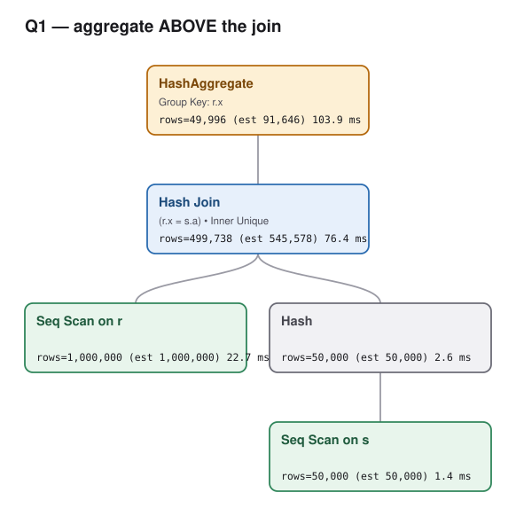
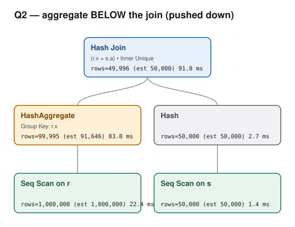

# QED §2 explained from scratch — every symbol, with SQL

Companion notes for **QED: A Powerful Query Equivalence Decider for SQL** (Wang, Pan, Cheung, PVLDB 17(11):3602), Section 2 "Overview".

Every SQL snippet below was executed against the local `mahgoubyahia` database (Postgres 18, `r(x,y)` and `s(a,b)` with a primary key on `s.a`). All outputs and timings are real.

**Files in this folder**

| file | what it is |
|---|---|
| `q1_plan.json` / `q2_plan.json` | `EXPLAIN (ANALYZE, VERBOSE, BUFFERS, FORMAT JSON)` — drop into **pgAdmin → Explain tab**, or paste into [explain.dalibo.com](https://explain.dalibo.com) (pev2) for an interactive graphical plan |
| `q1_plan.svg` / `q2_plan.svg` | rendered plan diagrams (embedded in Part 8) |
| `render_plan.py` | the JSON→SVG renderer; rerun after any new `EXPLAIN` |

**Reading order.** Parts 0–4 build the notation from nothing. Parts 5–7 are the "slides" that map SQL clauses onto the formulas. Part 8 onward is the actual paper content.

The sample data used throughout:

```
 r                 s
 x |  y            a |  b
---+----          ---+-----
 1 | 10            1 | 100
 1 | 20
 2 | 30
```

---

# Part 0 — The one idea everything rests on

SQL results are **bags** (multisets): duplicates matter. `{10, 20}` is not `{10, 10, 20, 20}`.

So instead of writing a table as a list of rows, write it as a **function that counts**:

> **`R(t)` = "how many copies of the row `t` are in table `R`?"**

```sql
select count(*) from r where x = 1 and y = 10;   --> 1
select count(*) from r where x = 1 and y = 99;   --> 0
```

| `t` | `R(t)` |
|---|---|
| `(1,10)` | 1 |
| `(1,20)` | 1 |
| `(2,30)` | 1 |
| `(1,99)` | 0 |
| every other row | 0 |

**A query is then a formula that computes the count of one output row.** Two queries are equivalent iff their formulas agree for every output row, on every possible input table. That formula is what QED calls a **Q-expression**.

---

# Part 1 — Symbol cheat sheet

| symbol | reads as | SQL counterpart |
|---|---|---|
| `R(x,y)` | count of row `(x,y)` in `R` | `FROM r` |
| `[P]` | `1` if `P` is true, else `0` | `WHERE P` |
| `×` | multiply counts | `JOIN` |
| `+` | add counts | `UNION ALL` |
| `Σ_a` | try every value of `a`, add up | `SELECT` that drops a column (projection) |
| `‖e‖` | clamp any count to `0` or `1` ("squash") | `DISTINCT`, `EXISTS` |
| `not(e)` | `1` if `e` is `0`, else `0` | `NOT EXISTS` |
| `λy. …` | an anonymous function — here, **a bag** | the group of rows feeding an aggregate |
| `Sum(λy. …)` | SQL's `SUM` over that bag | `SUM(y)` |

Now one at a time, each with a query you can run.

## 1.1 `R(x,y)` — a table is a counting function

```sql
select 1 as x, 10 as y, (select count(*) from r where r.x=1 and r.y=10) as "R(1,10)"
union all select 1, 20, (select count(*) from r where r.x=1 and r.y=20)
union all select 1, 99, (select count(*) from r where r.x=1 and r.y=99)
union all select 7,  7, (select count(*) from r where r.x=7 and r.y=7);
```
```
 x | y  | R(1,10)
---+----+---------
 1 | 10 |       1
 1 | 20 |       1
 1 | 99 |       0
 7 |  7 |       0
```

## 1.2 `[P]` — the bracket is literally a 0/1 column

`[P]` is called an **indicator**. Postgres will even print it for you:

```sql
select x, y, (x = 1)::int as "[x=1]", (y > 15)::int as "[y>15]" from r order by x,y;
```
```
 x | y  | [x=1] | [y>15]
---+----+-------+--------
 1 | 10 |     1 |      0
 1 | 20 |     1 |      1
 2 | 30 |     0 |      1
```

**Why this is useful:** `[P] × R(t)` *is* filtering. Multiply by `1` and the row survives with its count intact; multiply by `0` and it vanishes. So `WHERE` needs no new machinery — it's just multiplication.

## 1.3 `×` — multiplication is JOIN

A cross join pairs every left row with every right row, and the count of the pair is the **product** of the two counts.

```sql
select r.x, r.y, s.a,
       (select count(*) from r r2 where r2.x=r.x and r2.y=r.y) as "R(x,y)",
       (select count(*) from s s2 where s2.a=s.a)              as "S(a)",
       (select count(*) from r r2 where r2.x=r.x and r2.y=r.y)
     * (select count(*) from s s2 where s2.a=s.a)              as "product"
from r cross join s;
```
```
 x | y  | a | R(x,y) | S(a) | product
---+----+---+--------+------+---------
 1 | 10 | 1 |      1 |    1 |       1
 1 | 20 | 1 |      1 |    1 |       1
 2 | 30 | 1 |      1 |    1 |       1
```

Multiplication is why duplicates are contagious: if `S(a)` were `2`, every product would double. **Hold on to that** — it is the entire plot of Part 9.

## 1.4 `+` — addition is UNION ALL

```sql
select x, y, count(*) as multiplicity
from (select * from r union all select * from r) t group by x,y;
```
```
 x | y  | multiplicity
---+----+--------------
 1 | 10 |            2
 1 | 20 |            2
 2 | 30 |            2
```

`R(t) + R(t) = 2·R(t)`. ✓

## 1.5 `Σ_a` — projection

This is the one that trips everybody up. It gets all of **Part 2**.

## 1.6 `‖e‖` — squash

`‖e‖` is `1` when `e ≥ 1`, and `0` when `e = 0`. It throws away *how many* and keeps only *whether*.

```sql
select x, count(*) as "count", least(count(*),1) as "squashed" from r group by x;
```
```
 x | count | squashed
---+-------+----------
 1 |     2 |        1
 2 |     1 |        1
```

Squash is how you write three different SQL ideas:
- `SELECT DISTINCT` — every surviving row gets count 1
- `EXISTS (…)` — "at least one row", i.e. `‖Σ_t Q(t)‖`
- **`GROUP BY`** — one output row per distinct key, regardless of how many rows fed the group

## 1.7 `not(e)` — the opposite of squash

`not(e)` is `1` exactly when `e` is `0`. That's `NOT EXISTS`.

```sql
select xv as x, (select count(*) from s where s.a=xv) as "S(x)",
       (select count(*) from s where s.a=xv) = 0 as "not(S(x)) is 1?"
from generate_series(1,3) xv;
```
```
 x | S(x) | not(S(x)) is 1?
---+------+-----------------
 1 |    1 | f
 2 |    0 | t
 3 |    0 | t
```

## 1.8 `λy. …` — an anonymous function, used as a bag

`λy. <expr>` means "the function taking `y` to `<expr>`" — same as `lambda y:` in Python or `y -> ` in Java.

Since a bag *is* a counting function (Part 0), **writing `λy. R(1,y)` is writing a bag**:

```
y = 10  ↦  R(1,10) = 1
y = 20  ↦  R(1,20) = 1
y = 99  ↦  R(1,99) = 0
```

which is the bag `{10, 20}`.

## 1.9 `Sum(λy. …)` — the SQL aggregate

Gets all of **Part 3**.

---

# Part 2 — `Σ`, slowly

## 2.1 What it literally says

```
Σ_y  f(y)      =     "try EVERY possible value of y, and add up f(y)"
```

Every value. All integers, from minus infinity to plus infinity. That's why the papers call it an **unbounded summation** — the range is the entire domain of the variable's type, not a table.

## 2.2 Enumerate it and look

Take `Σ_y R(1,y)`. Here are the actual terms:

```sql
select yv as y, (select count(*) from r where r.x=1 and r.y=yv) as "R(1,y)"
from generate_series(8,22) yv;
```
```
  y | R(1,y)
----+--------
  8 |      0
  9 |      0
 10 |      1     <--
 11 |      0
 12 |      0
 ...            (all zero)
 20 |      1     <--
 21 |      0
 22 |      0
```

`Σ_y R(1,y) = … + 0 + 0 + 1 + 0 + … + 0 + 1 + 0 + 0 + …  =  2`

## 2.3 "Isn't an infinite sum infinite?" — No

**Almost every term is `0`.** A table has finitely many rows, so `R(1,y)` is non-zero for only finitely many `y`. Widening the range cannot change the answer:

```sql
select (select sum((select count(*) from r where r.x=1 and r.y=yv))
        from generate_series(0,30) yv)       as "range 0..30",
       (select sum((select count(*) from r where r.x=1 and r.y=yv))
        from generate_series(-1000,1000) yv) as "range -1000..1000";
```
```
 range 0..30 | range -1000..1000
-------------+-------------------
           2 |                 2
```

Same answer. The sum is *written* over an infinite range but is *finite* in value. (QED's semantic domain is `N̄ = ℕ ∪ {∞}` precisely so that the pathological infinite case is still well-defined rather than undefined.)

## 2.4 Why summing = "forget a column" = projection

Here is the point. `select x from r` **throws away `y`**. Two rows that differed only in `y` become the same row, so their counts must be **added together**.

```
     R                            select x from r
 x  |  y   | count                 x  | count
----+------+-------           →   ----+-------
 1  | 10   |   1               \    1  |   2      <-- 1 + 1
 1  | 20   |   1               /    2  |   1
 2  | 30   |   1                    

                    Σ_y R(x,y)
```

Verified — `Σ_y R(x,y)` is exactly `GROUP BY x` + `COUNT(*)`:

```sql
select x, count(*) as "Sigma_y R(x,y)" from r group by x;
```
```
 x | Sigma_y R(x,y)
---+----------------
 1 |              2
 2 |              1
```

> **`Σ_y` = "drop column `y` and merge the counts."** That's all projection is.

## 2.5 Two variables at once

`Σ_{y,a} f(y,a)` is just nested: try every `y`, and for each one try every `a`. It drops **two** columns.

## 2.6 The `[x = a]` pin — the most important pattern

What happens when the body of the sum contains an equality that mentions the summation variable?

```
Σ_a  [x = a] × S(a)
```

Every term where `a ≠ x` has `[x=a] = 0`, so the whole term is `0`. **Exactly one term survives: `a = x`.** The infinite sum collapses to a single value.

```sql
select av as a, (1 = av)::int as "[x=a] when x=1",
       (select count(*) from s where s.a=av) as "S(a)",
       (1 = av)::int * (select count(*) from s where s.a=av) as "term"
from generate_series(0,4) av;
```
```
 a | [x=a] when x=1 | S(a) | term
---+----------------+------+------
 0 |              0 |    0 |    0
 1 |              1 |    1 |    1     <-- the only survivor
 2 |              0 |    0 |    0
 3 |              0 |    0 |    0
 4 |              0 |    0 |    0
```

So `Σ_a [x=a] × S(a)` is just `S(x)` with extra steps.

**Why you care:** this is precisely what QED's *stabilization* step detects and removes (Part 10, Step 1). A join condition creates a pin; the pin makes a summation variable redundant; deleting it is what makes the two queries line up.

## 2.7 `Σ` vs `Sum` — two different things both called "sum"

This is the single most common confusion, so state it flatly:

| | adds up | SQL name | on the bag `{10, 20}` |
|---|---|---|---|
| `Σ_y f(y)` | **multiplicities** (how many) | `COUNT(*)` | `1 + 1 = 2` |
| `Sum(λy. f(y))` | **values × multiplicities** | `SUM(y)` | `10×1 + 20×1 = 30` |

```sql
select count(*) as "Sigma", sum(y) as "Sum" from r where x = 1;
```
```
 Sigma | Sum
-------+-----
     2 |  30
```

> **`Σ` is COUNT. `Sum` is SUM.** They look alike and mean different things.

---

# Part 3 — `Sum(λy. …)`, slowly

`Sum` eats a **whole bag** of numbers and returns **one** number:

```
Sum(b)  =  Σ over all values v of   v × b(v)
              ↑                     ↑    ↑
        every possible value    the value  how many copies
```

| bag | as a counting function | `Sum` |
|---|---|---|
| `{10, 20}` | `b(10)=1, b(20)=1` | `10×1 + 20×1 = 30` |
| `{10, 10, 20, 20}` | `b(10)=2, b(20)=2` | `10×2 + 20×2 = 60` |

Verified three ways:

```sql
-- (1) the ordinary way
select sum(y) from r where x = 1;                                              --> 30

-- (2) the same bag as (value, multiplicity) pairs
select y as value, count(*) as multiplicity from r where x=1 group by y;
--   value | multiplicity
--      10 |            1
--      20 |            1

-- (3) SUM recomputed from the counting function
select sum(value * multiplicity)
from (select y as value, count(*) as multiplicity from r where x=1 group by y) t;   --> 30

-- (4) every multiplicity DOUBLED
select sum(value * (multiplicity*2))
from (select y as value, count(*) as multiplicity from r where x=1 group by y) t;   --> 60
```

**Remember `30 → 60`.** Doubling the multiplicities doubles the sum. That is the whole argument of Part 9.

So:
- `Sum(λy. R(x,y))` — "SUM the bag of `y`s belonging to key `x`" = `select sum(y) from r where r.x = x`
- `Sum(λy. R(x,y) × ‖S(x)‖)` — the same bag, but every multiplicity multiplied by `‖S(x)‖`. If that factor is `1`, nothing changes. If it were `2`, the sum doubles.

**One thing QED deliberately does not do:** it never unfolds `Sum` into `Σ v × b(v)`. `Sum` is an **uninterpreted operator** — a black box. The only fact available is

> **same bag in ⇒ same number out** (congruence)

so proving `Sum(bag₁) = Sum(bag₂)` forces you to prove `bag₁ = bag₂`. That's the recursive check in Part 10, Step 3.

*(SQLSolver, by contrast, interprets `SUM`/`COUNT`/`AVG` concretely — which is why it can prove `sum` of a bag of `count`s equals one big `count`, and QED cannot. Aggregates are QED's largest failure category on Calcite: 96 cases.)*

---

# Part 4 — Squash or no squash?

Everything so far had a `‖·‖` wrapped around it, which can leave the impression that squash is always there. It isn't. **Bag semantics is the default; squash is the exception**, added only by specific SQL constructs.

| SQL construct | adds a squash? |
|---|---|
| `FROM`, `WHERE`, `JOIN`, `UNION ALL`, plain `SELECT col` | **no** |
| `SELECT DISTINCT` | yes, on the output |
| `GROUP BY` | yes — one row per key |
| `EXISTS (…)`, `IN (…)` | yes, on the subquery |
| `EXCEPT` / `INTERSECT` (set versions) | yes |
| `COUNT(DISTINCT y)`, `SUM(DISTINCT y)` | yes — *inside the bag* (see 4.5) |
| a `PRIMARY KEY` on a table | yes — on that table's counting function |

## 4.1 Σ without squash: plain projection

The simplest unsquashed Σ in all of SQL:

```
select x from r                 -->    Q(x) =   Σ_y R(x,y)
select distinct x from r        -->    Q(x) = ‖ Σ_y R(x,y) ‖
```

```sql
select x, count(*) as multiplicity from (select x from r) t group by x;
--   x | multiplicity        <-- NO squash: x=1 appears twice
--   1 |            2
--   2 |            1

select x, count(*) as multiplicity from (select distinct x from r) t group by x;
--   x | multiplicity        <-- squash: everything clamped to 1
--   1 |            1
--   2 |            1
```

> **The squash *is* the `DISTINCT`.** Remove it from the formula and you have described a different query.

## 4.2 An unsquashed rewrite QED can prove: double self-join on a key

This is QED §6.3.2 (`JoinJoinRemove`), which has **no squash anywhere at the top level** — the answer genuinely has multiplicity 2.

```sql
-- Q1                                            -- Q2
select r.x from r                                select r.x from r
  join s s1 on r.x = s1.a                          join s on r.x = s.a;
  join s s2 on r.x = s2.a;
```
```
Q1:  x | multiplicity          Q2:  x | multiplicity
     1 |            2               1 |            2      <-- equal, and NOT 1
```

In the algebra, with `s.a` a primary key (so `S ⇝ λa.‖S(a)‖`):

```
Q1(x) = Σ_{y,k₁,k₂} [x=k₁] × [x=k₂] × R(x,y) × ‖S(k₁)‖ × ‖S(k₂)‖
                                                       ↓  stabilize: the pins force k₁ = k₂ = x
      = Σ_y R(x,y) × ‖S(x)‖ × ‖S(x)‖
                                                       ↓  ‖a‖ × ‖a‖ = ‖a‖  (squash is idempotent)
      = Σ_y R(x,y) × ‖S(x)‖   =   Q2(x)                ✓
```

**How QED discharges an unsquashed Σ:** it cannot turn the sum into `∃` — the actual count matters. Instead it uses eq. (14),

```
(∀s. f(s) = g(s))  →  Σ_s f(s) = Σ_s g(s)
```

i.e. **prove the summands equal pointwise, under the same summation scope**. Here, for every single `y`, `R(x,y)×‖S(x)‖×‖S(x)‖ = R(x,y)×‖S(x)‖`. Sound, and it needs no arithmetic reasoning about the sum itself.

That requirement — *same scope, matched pointwise* — is why stabilization (Part 2.6) and scope permutation exist, and it is the ceiling on QED's power (4.6).

## 4.3 `IN` vs `JOIN`: exactly one squash apart

The classic SQL gotcha, explained by one symbol:

```
select * from r where x in (select a from s)   -->  R(x,y) × ‖ Σ_a [x=a] × S(a) ‖
select r.* from r join s on r.x = s.a          -->  Σ_a [x=a] × R(x,y) × S(a)
                                                    ↑ no squash — S's count multiplies through
```

Give `s` a duplicate (`a = 1` twice, no key) and run both:

```
IN   :  x | y  | multiplicity        JOIN :  x | y  | multiplicity
        1 | 10 |            1                1 | 10 |            2
        1 | 20 |            1                1 | 20 |            2
```

`IN` asks *"does a match exist?"* — squashed, so `r`'s rows pass through unchanged. `JOIN` asks *"pair with every match"* — unsquashed, so `r`'s counts get multiplied by `S(a)`.

Note this is a **mixed** expression: the squash is *inside*, on the subquery, while the outer expression is unsquashed. Squash is a local operator, not a global mode.

Restore the primary key and `‖S(a)‖ = S(a)`, so the two collapse to the same thing — which is why the rewrite `IN → JOIN` is valid **only** on a unique column.

## 4.4 The same question for `Sum`

The analogue of "squash or not" for an aggregate is **`DISTINCT` inside the aggregate**, and it lands *inside the bag*:

| SQL | Q-expression | reads as |
|---|---|---|
| `COUNT(*)` | `Σ_y R(x,y)` | add up the multiplicities |
| `COUNT(DISTINCT y)` | `Σ_y ‖R(x,y)‖` | add up 1 per *distinct* `y` |
| `SUM(y)` | `Sum(λy. R(x,y))` | each `y` counted as often as it occurs |
| `SUM(DISTINCT y)` | `Sum(λy. ‖R(x,y)‖)` | each distinct `y` counted once |

Verified on the bag `{10, 10, 20}`:

```sql
with rd(x,y) as (values (1,10),(1,10),(1,20))
select count(*), count(distinct y), sum(y), sum(distinct y) from rd where x = 1;
```
```
 count(*) | count(distinct y) | sum(y) | sum(distinct y)
----------+-------------------+--------+-----------------
        3 |                 2 |     40 |              30
```

- `Σ_y R(1,y)` = `2 + 1` = **3**  ·  `Σ_y ‖R(1,y)‖` = `1 + 1` = **2**
- `Sum(λy. R(1,y))` = `10×2 + 20×1` = **40**  ·  `Sum(λy. ‖R(1,y)‖)` = `10×1 + 20×1` = **30**

> **Squash inside the bag = `DISTINCT` inside the aggregate.** Same symbol, one level deeper.

And note the symmetry with Part 2.7: `Σ` vs `Sum` is *count vs value*; `‖·‖` vs nothing is *distinct vs all*. The four combinations are exactly SQL's four aggregate forms.

## 4.5 Why Q2 was squashable at all — the key again

In Part 10 both queries are written with an outer `‖·‖`. For Q1 that comes straight from `GROUP BY`. For **Q2** it is *earned*:

```
Q2(x,r) = Σ_a [x=a] × ‖Σ_y R(x,y)‖ × [r = Sum(λy. R(x,y))] × ‖S(a)‖
                     ╰──── 0 or 1 ───╯ ╰───── 0 or 1 ─────╯   ╰ 0 or 1 ╯
```

Every factor is already `0`-or-`1`, so the product is too, and wrapping it in `‖·‖` changes nothing. **But `‖S(a)‖` is only squashed because of the primary key.** Drop the key and the last factor becomes `S(a) = 2`, the product becomes `2`, and Q2 is no longer squashable — which is precisely the counterexample in Part 9 (`(1,30)` twice).

So the primary key does double duty: it is both the fact the proof needs *and* the reason the two sides have the same shape.

## 4.6 Why any of this matters to the prover

This is the practical payoff, and it decides which queries QED can handle.

**Squashed at the top** — QED never has to think about numbers. It rewrites `U ≠ 0` inward (`Σ ⇝ ∃`, `× ⇝ ∧`, `+ ⇝ ∨`, `[P] ⇝ P`), producing an ordinary boolean formula for the SMT solver. The unbounded sums simply evaporate into existentials. That's the Part 10 proof.

**Not squashed** — the multiplicities are the answer, so QED must compare them. It normalizes into terms `Σ_s [L] × V`, aligns the summation scopes, and compares pointwise via eq. (14). Its general algorithm (Alg. 6) additionally requires a **bijection between the two sides' terms**; its complete-fragment algorithm (Alg. 3) relaxes that to "same relational scope" but only applies inside `F_T`.

Consider this valid rewrite:

```sql
(select x from r where y <= 15) union all (select x from r where y > 15)
=
 select x from r
```

Both sides really are equal — verified:

```
split union all:  x=1 → 2,  x=2 → 1          select x from r:  x=1 → 2,  x=2 → 1
```

But algebraically:

```
left  =  Σ_y [y≤15] × R(x,y)  +  Σ_y [y>15] × R(x,y)      <-- TWO terms
right =  Σ_y R(x,y)                                        <-- ONE term
```

**QED has two algorithms, and they behave differently here.** This query uses only `Table`/`Filter`/`Proj`/`Union`, so it sits inside the complete fragment `F_T` and QED takes Algorithm A (Alg. 3), which groups terms by *relational scope* and compares the **sum of their bodies**:

```
Σ_{R(s)} [P₁] + [P₂]   ?=   Σ_{R(s)} [P₃]        checked pointwise, n ≠ m allowed
```

Both left terms have scope `R¹(s)`, and `[P₁]+[P₂] = [P₃]` holds for every `s` because the two filters are disjoint and cover the disjunction. **So QED proves this one** — it is in fact the paper's own motivating example for that step.

The bijection requirement belongs to Algorithm B (Alg. 6), which QED uses for anything *outside* `F_T` — the moment a `GROUP BY`, `DISTINCT`, `EXCEPT` or unknown operator appears. There, `unify` returns `Unknown` as soon as the two sides have different numbers of terms. And **neither** QED algorithm can relate sums with *different relational scopes*.

That is the real boundary, and it is what SQLSolver's LIA\* removes: LIA\* needs no fragment membership, no shared scope, and keeps working under aggregates, nesting and non-linearity.

Now add `DISTINCT` to both sides. The `+` becomes `∨`, everything reduces to booleans, and an SMT solver settles it instantly regardless of structure:

```
∃y. (y≤15 ∧ R(x,y)≠0)  ∨  ∃y. (y>15 ∧ R(x,y)≠0)     ↔     ∃y. R(x,y)≠0
```

> **The squash is the difference between a boolean question and an arithmetic one.** Under a squash, any SMT-backed prover wins. Without one, you need alignable scopes (QED) or real reasoning about sums (LIA\*).

---

# Part 5 — SLIDE: building **Q1**, clause by clause

```
╔════════════════════════════════════════════════════════════════════════════╗
║  Q1  —  aggregate ABOVE the join                                           ║
╟────────────────────────────────────────────────────────────────────────────╢
║                                                                            ║
║      select x, sum(y) as r          <-- (5)  the aggregate                 ║
║      from   r                       <-- (1)  base table                    ║
║             join s                  <-- (2)  pair them up                  ║
║             on r.x = s.a            <-- (3)  keep matching pairs           ║
║      group by x                     <-- (4)  collapse y and a              ║
║                                                                            ║
╚════════════════════════════════════════════════════════════════════════════╝
```

Build it bottom-up. At each step, "the row" is whatever the operator emits, and the formula is its count.

| # | SQL clause | what it does to the bag | formula so far |
|---|---|---|---|
| **1** | `from r` | rows are `(x,y)` | `R(x,y)` |
| **2** | `join s` | rows are now `(x,y,a)`; counts multiply | `R(x,y) × S(a)` |
| **·** | *`s.a` is a PRIMARY KEY* | clamp `S` to at most one copy per `a` | `R(x,y) × ‖S(a)‖` |
| **3** | `on r.x = s.a` | kill the non-matching pairs | `[x=a] × R(x,y) × ‖S(a)‖` |
| **4** | `group by x` | one output row per distinct `x`, so drop `y` and `a` and squash | `‖ Σ_{y,a} [x=a] × R(x,y) × ‖S(a)‖ ‖` |
| **5** | `sum(y) as r` | the output row is `(x, r)`; pin `r` to the aggregate of the group's `y`-bag | `× [ r = Sum(λy. Σ_a [x=a] × R(x,y) × ‖S(a)‖) ]` |

**Two things worth pausing on.**

*Step 4, why the squash:* `GROUP BY` emits **one** row per key no matter how many rows fed the group. `Σ_{y,a}` counts the group's rows; `‖·‖` then throws that count away and keeps only "the group is non-empty". Postgres agrees — its `HashAggregate` reports `rows=49996` for 499,738 input rows (Part 8).

*Step 5, where the bag comes from:* inside `Sum` we need the bag of `y` values in this group. For a given `y`, its multiplicity in the group is `Σ_a [x=a] × R(x,y) × ‖S(a)‖` — the same joined expression, but summed over `a` only, because `y` is the thing we're collecting and must stay free.

### The finished expression

```
Q1(x,r) = ‖ Σ_{y,a} [x=a] × R(x,y) × ‖S(a)‖ ‖ × [ r = Sum(λy. Σ_a [x=a] × R(x,y) × ‖S(a)‖) ]
            ╰──4──╯ ╰─3─╯   ╰─1──╯   ╰─2──╯     ╰────────────────────5─────────────────────╯
                                                              ╰4╯ ╰─3─╯   ╰─1──╯   ╰─2──╯
```

The bottom tier shows the same pieces reappearing **inside** the aggregate — because `SUM` is computed over the *joined* rows.

---

# Part 6 — SLIDE: building **Q2**, clause by clause

```
╔════════════════════════════════════════════════════════════════════════════╗
║  Q2  —  aggregate BELOW the join   (Calcite's AggregateJoinTransposeRule)  ║
╟────────────────────────────────────────────────────────────────────────────╢
║                                                                            ║
║      select t.x, t.r                          <-- (5)  drops column a      ║
║      from  ( select x, sum(y) as r            <-- (3)  the aggregate       ║
║              from r                           <-- (1)  base table          ║
║              group by x ) t                   <-- (2)  collapse y          ║
║            join s on t.x = s.a                <-- (4)  join comes LAST     ║
║                                                                            ║
╚════════════════════════════════════════════════════════════════════════════╝
```

| # | SQL clause | what it does to the bag | formula so far |
|---|---|---|---|
| **1** | inner `from r` | rows are `(x,y)` | `R(x,y)` |
| **2** | inner `group by x` | one row per distinct `x`; drop `y`, squash | `‖ Σ_y R(x,y) ‖` |
| **3** | inner `sum(y) as r` | subquery rows are `(x, r)` | `× [ r = Sum(λy. R(x,y)) ]` |
| **4** | `join s on t.x = s.a` | rows are `(x,r,a)`; multiply and filter | `× ‖S(a)‖ × [x=a]` |
| **5** | `select t.x, t.r` | column `a` is dropped → sum it away | `Σ_a …` |

**The one difference that matters:** at step 3 the bag inside `Sum` is `λy. R(x,y)` — **plain `R`, no `S` factor**, because the join hasn't happened yet.

### The finished expression

```
Q2(x,r) = Σ_a [x=a] × ‖ Σ_y R(x,y) ‖ × [ r = Sum(λy. R(x,y)) ] × ‖S(a)‖
          ╰5╯ ╰─4─╯   ╰─────2──────╯   ╰──────────3──────────╯   ╰─4──╯
                            ╰─1──╯                   ╰─1──╯
```

---

# Part 7 — SLIDE: the two, side by side

```
╔═══════════════════════════════════════════════════════════════════════════════════╗
║                                                                                   ║
║   Q1   select x, sum(y) as r from r join s on r.x = s.a group by x                ║
║                                                                                   ║
║        ‖ Σ_{y,a} [x=a] × R(x,y) × ‖S(a)‖ ‖ × [ r = Sum( λy. R(x,y) × ‖S(a)‖ ) ]   ║
║                                                         ╰────────┬────────╯       ║
║                                                       SUM over the JOINED bag     ║
║   ─────────────────────────────────────────────────────────────────────────────   ║
║                                                                                   ║
║   Q2   select t.x, t.r from (select x, sum(y) as r from r group by x) t           ║
║                             join s on t.x = s.a                                   ║
║                                                                                   ║
║          Σ_a [x=a] × ‖ Σ_y R(x,y) ‖  ×  [ r = Sum( λy. R(x,y) ) ]  × ‖S(a)‖       ║
║                                                    ╰───┬────╯                     ║
║                                               SUM over the RAW bag                ║
║                                                                                   ║
╚═══════════════════════════════════════════════════════════════════════════════════╝
```

*(the `Σ_a` inside Q1's aggregate has already been collapsed by the `[x=a]` pin of Part 2.6, to line the two up)*

**Everything reduces to one question:** is `Sum` over the joined bag the same as `Sum` over the raw bag?

By Part 3, those differ only if `‖S(x)‖` is ever anything other than `1` for a group that actually appears in the output. Proving it never is — *that* is the proof in Part 10.

---

# Part 8 — The real Postgres plans

**Postgres does not perform this rewrite itself**, so the two SQL texts genuinely produce two different plans. That's what makes them a good demo.

## 7.1 Small data (the 3 rows in `r`, 1 row in `s`)

Both return `{(1, 30)}`.

```
Q1  — Aggregate on top                    Q2  — Aggregate pushed down
───────────────────────────────────       ─────────────────────────────────
HashAggregate  rows=1                     Hash Join  rows=1
  Group Key: r.x                            Inner Unique: true
  -> Hash Join  rows=2                      Hash Cond: (s.a = r.x)
       Inner Unique: true                   -> Seq Scan on s   rows=1
       Hash Cond: (r.x = s.a)               -> Hash  rows=2
       -> Seq Scan on r   rows=3                 -> HashAggregate  rows=2
       -> Hash  rows=1                                Group Key: r.x
            -> Seq Scan on s  rows=1                  -> Seq Scan on r  rows=3
```

**`Aggregate` and `Join` have swapped places.** That is the entire rewrite.

Also look at what Postgres prints on the join: **`Inner Unique: true`**. The planner read the primary key and recorded "at most one match on the inner side". *That flag is exactly the fact QED writes as `‖S(a)‖`* — Postgres uses it to stop probing after the first match, QED uses it to prove the rewrite correct. Same fact, two purposes.

## 7.2 Realistic size (1,000,000 rows in `r`, 50,000 in `s`, both `ANALYZE`d)

*(SVGs come from a second `EXPLAIN (FORMAT JSON)` run in the same session, so per-node timings differ by ~1 ms from the text below. Row counts are identical.)*

### Q1 — aggregate above the join



```
HashAggregate  (cost=21125.01..22041.47 rows=91646) (actual time=103.200..104.671 rows=49996)
  Group Key: r.x
  ->  Hash Join  (cost=1347.00..18397.12 rows=545578) (actual time=2.464..76.505 rows=499738)
        Inner Unique: true
        Hash Cond: (r.x = s.a)
        ->  Seq Scan on r  (actual time=0.005..22.677 rows=1000000)
        ->  Hash           (actual time=2.454..2.454 rows=50000)
              ->  Seq Scan on s  (actual time=0.002..1.190 rows=50000)
Execution Time: 105.544 ms
```

### Q2 — aggregate pushed below the join



```
Hash Join  (cost=20772.00..21929.04 rows=50000) (actual time=83.679..92.272 rows=49996)
  Inner Unique: true
  Hash Cond: (r.x = s.a)
  ->  HashAggregate  (cost=19425.00..20341.46 rows=91646) (actual time=81.074..84.148 rows=99995)
        Group Key: r.x
        ->  Seq Scan on r  (actual time=0.006..22.517 rows=1000000)
  ->  Hash             (actual time=2.602..2.602 rows=50000)
        ->  Seq Scan on s  (actual time=0.008..1.359 rows=50000)
Execution Time: 93.078 ms
```

### What actually changed

| | Q1 (agg above) | Q2 (agg below) |
|---|---|---|
| rows entering the aggregate | 499,738 | 1,000,000 |
| groups produced | 49,996 | 99,995 |
| rows entering the join | 1,000,000 | 99,995 |
| final rows | 49,996 | 49,996 |
| execution time | **105.5 ms** | **93.1 ms** |

Honest note: pushing down is only ~12% faster *here*, and Q2's aggregate does **more** work (all 1M rows, including the ~50% the join would have discarded). The win comes from the join afterwards handling 99,995 rows instead of 1,000,000. With a less selective join, or more rows per group, the gap widens. That's a cost-model question — **entirely separate from whether the rewrite is correct**, which is the prover's job.

Equivalence spot-checked on 200,000 rows, both directions with `EXCEPT ALL`: `0` rows each way.

---

# Part 9 — Why the primary key is load-bearing

Testing forever proves nothing, but **one counterexample disproves everything**. Drop the key and the rewrite dies. Give `s` a duplicate:

```
 s
 a |  b
---+-----
 1 | 100
 1 | 100     <-- duplicate; no primary key now
```

Same two queries, same `r`:

| | result | rows |
|---|---|---|
| **Q1** (agg above join) | `(1, 60)` | 1 |
| **Q2** (agg below join) | `(1, 30)`, `(1, 30)` | 2 |

**Not equivalent — and wrong in two independent ways at once.**

```
GroupAggregate  rows=1                    <-- one row out, but sum = 60
  Group Key: r.x
  ->  Merge Join  rows=4                  <-- 4 rows now, and Inner Unique is GONE
        Merge Cond: (r.x = s.a)
        ->  Sort -> Seq Scan on r  rows=3
        ->  Sort -> Seq Scan on s  rows=2
```

- **Q1 joins first**, so every `r` row is duplicated *before* the aggregate sees it. The bag entering `SUM` becomes `{10, 10, 20, 20}` instead of `{10, 20}` — by Part 3, that's `60` instead of `30`. **The value is corrupted.**
- **Q2 aggregates first**, so `SUM` sees the clean bag `{10, 20}` = `30`. The duplication hits the *output row* instead: two copies of `(1, 30)`. **The row count is corrupted.**

And `Inner Unique: true` **disappears** from Q1's plan the moment the key is gone. Postgres and QED track the same property; Postgres just never has to prove anything with it.

### The same thing in the algebra

Set `S(1) = 2` (no squash, since there's no key) and evaluate:

- `Q1(1,60)`: the bag is `λy. R(1,y)×2 = {10↦2, 20↦2}`, so `Sum = 60`. → **`Q1(1,60) = 1`**, and `Q1(1,30) = 0`
- `Q2(1,30)` = `1 × 1 × 1 × S(1)` = **`2`**, and `Q2(1,60) = 0`

Exactly the Postgres output: one row of `(1,60)` from Q1, two rows of `(1,30)` from Q2. The algebra is a faithful model of what the engine does.

> **Takeaway:** a prover that can't turn "`a` is a primary key" into a usable mathematical fact cannot prove this rewrite — and one that proves it *without* using the key is unsound. SPES fails for the first reason: its PK support is a couple of preprocessing rules, and none fires on this plan shape.

---

# Part 10 — How QED proves it (with the key)

Recall the primary-key rule (QED eq. 8): given `s.a PRIMARY KEY`, replace the table `S` everywhere by `λa.‖S(a)‖`. One rewrite, at the semantics level, proven to yield an equivalent equivalence problem. It's the algebraic twin of `Inner Unique: true`.

### Step 1 — Stabilize: delete the pointless `Σ_a`

Both formulas sum over `a` while asserting `[x=a]` — the pin from Part 2.6. Exactly one term survives, so substitute `a := x` and drop the sum:

```
Q1(x,r) = ‖ Σ_y R(x,y) × ‖S(x)‖ × [ r = Sum(λy. R(x,y) × ‖S(x)‖) ] ‖
Q2(x,r) = ‖ Σ_y R(x,y) × ‖S(x)‖ × [ r = Sum(λy. R(x,y)         ) ] ‖
                                                     ↑
                                     the ONLY remaining difference
```

*How QED finds this:* it asks the SMT solver for the **congruence classes** of the terms; `x` and `a` come back in the same class, so `a` is provably redundant. UDP could only do this by syntactic pattern-match — write the join condition as `x - a = 0` and syntactic matching breaks, while SMT doesn't care.

### Step 2 — Encode to logic: `Σ` becomes `∃`

Everything sits under a squash, so actual counts stop mattering — only zero vs non-zero. QED pushes `≠ 0` inward mechanically (`Σ ⇝ ∃`, `× ⇝ ∧`, `+ ⇝ ∨`, `‖U‖ ⇝ U`, `[P] ⇝ P`) and replaces each aggregate with a fresh opaque variable:

```
φ₁(x,r) = ∃y. R(x,y)≠0 ∧ S(x)≠0 ∧ r = v₁     where  v₁ = Sum(λy. R(x,y) × ‖S(x)‖)
φ₂(x,r) = ∃y. R(x,y)≠0 ∧ S(x)≠0 ∧ r = v₂     where  v₂ = Sum(λy. R(x,y))
```

Goal: `∀x,r. φ₁ ↔ φ₂`. These are now identical **except for `v₁` vs `v₂`**. Everything reduces to: *is `v₁ = v₂`?*

### Step 3 — Check the aggregates *in context* (the novel bit)

Since `Sum` is uninterpreted (Part 3), `v₁ = v₂` requires the two bags to be equal:

```
λy. R(x,y) × ‖S(x)‖   ≡   λy. R(x,y)
```

**Checked on its own this is FALSE** — if `x` doesn't occur in `S` at all then `‖S(x)‖ = 0`, the left bag is empty and the right one isn't. This is exactly where UDP and SPES stop: they check a subquery inside an opaque operator as an isolated query, get "not equivalent", and give up.

QED's move: run the recursive check **under the extra assumption `φ₁ ∨ φ₂`** — the conditions of the enclosing terms.

*Why that's sound, in one sentence:* if neither `φ₁` nor `φ₂` held, both terms would already be `0` and therefore equal, so whatever we conclude about `v₁`/`v₂` couldn't change the outcome.

*Why it works here:* `φ₁ ∨ φ₂` **contains `S(x) ≠ 0`** — the exact missing premise. Given that, `‖S(x)‖ = 1`, so:

```
(φ₁ ∨ φ₂)  →  ∀y. R(x,y) × ‖S(x)‖ = R(x,y)          ✓ valid
```

Therefore `v₁ = v₂`, therefore `φ₁ ↔ φ₂`, therefore **Q1 ≡ Q2**. ∎

**In plain English:** the group-by only ever emits a row for an `x` that survived the join, and any such `x` is guaranteed to be in `S` — so *inside the aggregate*, `‖S(x)‖` is just `1` and harmlessly vanishes. Obvious to a human. The `φ₁ ∨ φ₂` trick is how you make a solver see it.

---

# Part 11 — Scoreboard: where each prover dies

| tool | outcome |
|---|---|
| **Postgres planner** | Doesn't attempt the rewrite — but *does* derive the same key fact (`Inner Unique: true`) for execution purposes |
| **SPES** | Fails. PK support is a few preprocessing rewrite rules; none fires on this shape. Without distinctness the rewrite genuinely isn't valid, so "unknown" is the correct answer |
| **UDP** (U-expressions, syntactic) | Fails twice: (a) normalization is syntactic, so `Σ_a` only cancels in recognized shapes; (b) it checks the aggregate's subquery context-free and gets `R(x,y)×‖S(x)‖ ≢ R(x,y)` — true but useless |
| **SQLSolver** (U-expressions + LIA\*) | Different profile: interprets `SUM` concretely, so it is strong where QED is weak. But its power is reasoning about the *values* of unbounded sums; this example's difficulty is a primary key interacting with an opaque operator's scope, which isn't what LIA\* addresses |
| **QED** | Proves it. PK ⇒ `‖S(a)‖` (usable at every occurrence, composing with join and group-by for free) + SMT congruence classes for redundant-variable elimination + the `φ₁ ∨ φ₂` ambient assumption on the recursive check |

**Moral:** the two queries differ only in *where the join sits relative to the aggregate*, and that difference is invisible to a prover unless the formalism can (1) express "no duplicates" as arithmetic and (2) carry the enclosing context into a subquery check. Q-expressions are engineered for both; classical U-expressions were not.

---

# Reproducing this

```bash
export PATH="/Applications/Postgres.app/Contents/Versions/18/bin:$PATH"
psql -d mahgoubyahia
```

```sql
select * from r;   --  (1,10), (1,20), (2,30)
select * from s;   --  (1,100)

-- the no-PK counterexample, non-destructively:
-- a session-local table named s hides the real one; the real table is untouched
create temp table s (a int, b int);
insert into s(a,b) values (1,100),(1,100);
select x, sum(y) from r join s on r.x = s.a group by x;                                -- (1,60)
select t.x, t.r from (select x, sum(y) as r from r group by x) t join s on t.x = s.a;  -- (1,30) x2
```

Regenerate the SVGs after a new `EXPLAIN (FORMAT JSON)`:

```bash
cd qed-notes && python3 render_plan.py
```

**Cleanup** — these notes inserted 3 rows into `r` and 1 into `s`. To restore empty tables: `truncate r; truncate s;`

## References

- QED — [PVLDB 17(11):3602](https://www.vldb.org/pvldb/vol17/p3602-wang.pdf) · [github.com/qed-solver/prover](https://github.com/qed-solver/prover)
- SQLSolver — [PACMMOD 1(4), Art. 227](https://dl.acm.org/doi/10.1145/3626768) · [github.com/SJTU-IPADS/SQLSolver](https://github.com/SJTU-IPADS/SQLSolver)
- SPES — Zhou et al., ICDE 2022
